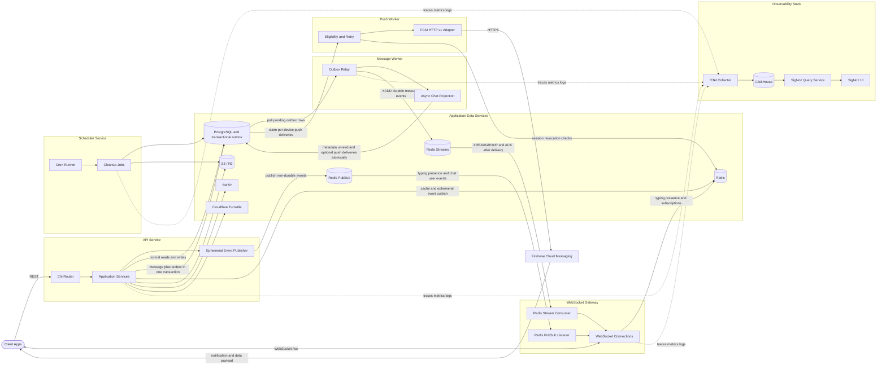
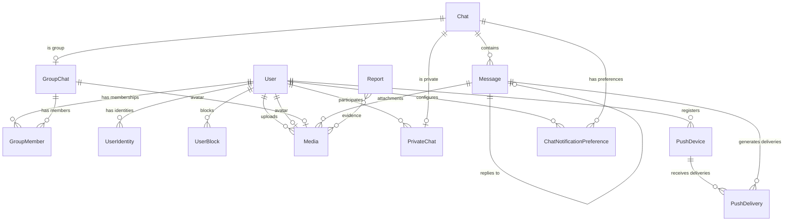

# Atoi-Talk-API

RESTful API and event-driven services for real-time chat applications. Handles authentication, private/group messaging, media uploads, durable event production, and background cleanup jobs. WebSocket connections are served by the separate WebSocket Gateway. Built with Go, PostgreSQL, Redis, and S3-compatible storage.

See [Atoi-Talk](https://github.com/Hilmi-Raif/Atoi-Talk) for an example frontend.

## Service Guides

Each service has its own README. Select a service below for its dependencies,
required and optional configuration, native/Docker commands, and health checks.

| Service documentation | Responsibility | Dependencies |
|---|---|---|
| [API](cmd/api/README.md) | HTTP endpoints, authentication, message and outbox writes | PostgreSQL, Redis, S3; SMTP for OTP |
| [Message worker](cmd/message_worker/README.md) | Outbox projection, realtime publishing and optional push enqueue | PostgreSQL, Redis, S3 |
| [WebSocket gateway](cmd/websocket_gateway/README.md) | Socket delivery, presence and typing | PostgreSQL, Redis |
| [Scheduler](cmd/scheduler/README.md) | Entity, private-chat and media cleanup | PostgreSQL, S3 |
| [Push worker](cmd/push_worker/README.md) | Durable per-device FCM delivery | PostgreSQL, Redis, Firebase ADC |

See [Configuration](docs/configuration.md) for shared environment-loading, networking, credentials, and telemetry settings.

- [Getting started](#getting-started)
- [Configuration](docs/configuration.md)
- [API documentation](#api-docs)
- [Notifications](cmd/api/README.md#notification-clients)
- [Contributing](#contributing)

## Architecture

The system runs as separate API, message-worker, optional push-worker, websocket-gateway, and scheduler services sharing the same codebase and PostgreSQL source of truth:



### Event-Driven Flow

Durable message events use the transactional outbox pattern. The API stores the message and its outbox record in the same PostgreSQL transaction. The message worker polls eligible outbox records, applies asynchronous chat metadata and unread projections, then publishes targeted events to the `events:messages` Redis Stream. The WebSocket Gateway consumes the stream with a per-instance consumer group and acknowledges an event only after it has been delivered to local connections.

Redis Streams provide buffering, consumer groups, pending-entry recovery, and at-least-once delivery for message events. Consumers use stable event identifiers and bounded deduplication because a worker or gateway can crash after publishing or before acknowledging an event. PostgreSQL remains the durable source of truth and the outbox is retried when Redis is unavailable.

Ephemeral events such as typing, presence, and non-durable chat or user updates use the `events:broadcast` Redis Pub/Sub channel. These events are intentionally best-effort and are not used as the durable message delivery path. Clients can recover missed durable messages from PostgreSQL-backed history after reconnecting.

## Data Model



## Features

### Auth & Accounts

- Email/password registration with OTP email verification
- Google OAuth login
- JWT-based session management with token blacklisting
- Password reset via OTP
- Cloudflare Turnstile captcha on sensitive endpoints
- Account deletion (soft delete with configurable retention)

### Messaging

- Private 1-on-1 chats
- Group chats with roles (owner, admin, member)
- Text messages with file/image attachments
- Message editing and deletion
- Read receipts and unread counts
- Chat delete

### Groups

- Public and private groups
- Invite links with reset capability
- Member management (kick, role changes, ownership transfer)
- Group dissolution
- Searchable public group directory

### Real-Time

- WebSocket connection with JWT auth
- Events: `message.new`, `message.update`, `message.delete`, `chat.new`, `chat.read`, `chat.typing`, `user.online`, `user.offline`, `user.update`, `user.block`, `user.banned`, `user.deleted`, and more
- Redis Streams for durable message delivery and Redis Pub/Sub for ephemeral events such as typing and presence
- Online presence tracking with TTL-based keepalive

### Notifications

- Optional FCM push delivery with durable per-device queues and bounded retries
- Installation registration bound to the authenticated session
- Account-wide notification settings and timed or indefinite per-chat mute
- Cursor-paginated muted conversations and batched mute status in chat responses

### Media

- File upload to S3-compatible storage (tested with Cloudflare R2)
- Public and private buckets
- Presigned URLs for private file access
- Orphan media cleanup by scheduler

### Admin

- Dashboard stats
- User management (view, ban, unban, reset profile)
- Group management (view, dissolve, reset info)
- Report system (view, resolve, delete)

### Scheduler Jobs

- **Entity cleanup**: hard-deletes users and chats past the soft-delete retention period
- **Private chat GC**: removes abandoned private chats where both users are gone
- **Media cleanup**: deletes orphaned files from S3 and database

## Tech Stack

| Layer | Technology |
|---|---|
| Language | Go 1.26 |
| Router | Chi v5 |
| ORM | Ent |
| Database | PostgreSQL |
| Cache / PubSub / Streams | Redis |
| Storage | S3 (Cloudflare R2) |
| Auth | JWT, Google OAuth2, bcrypt |
| WebSocket | gorilla/websocket |
| Validation | go-playground/validator |
| Email | SMTP (Mailpit or Mailtrap for dev) |
| Scheduler | robfig/cron |
| Push notifications | Firebase Cloud Messaging (HTTP v1) |
| Instrumentation | OpenTelemetry (traces, metrics, logs) |
| Telemetry collection | OpenTelemetry Collector (OTLP) |
| Observability backend | SigNoz, ClickHouse |
| Docs | Swagger (swag), AsyncAPI |
| Captcha | Cloudflare Turnstile |

## Project Structure

```
cmd/
  api/                       # API entrypoint
  message_worker/            # Outbox relay entrypoint
  push_worker/               # Optional push delivery entrypoint
  websocket_gateway/         # WebSocket entrypoint
  scheduler/                 # Scheduler entrypoint

internal/
  api/
    http/                    # Controllers, middleware, routes, responses
    application/             # Feature-oriented application services
  bootstrap/                 # Dependency wiring
  domain/                    # Constants, DTOs, domain helpers
  infrastructure/
    database/                # Repositories, query helpers, response mappers
    redis/                   # Cache, Pub/Sub, Streams
    object_storage/
    email/
    fcm/                     # Sender contract, provider errors, HTTP v1 adapter
    mocks/                   # Generated infrastructure mocks
    captcha/
    config/
    observability/
  messaging/
    events/                  # Shared event contracts
    outbox/                  # Atomic outbox helpers
    pubsub/                  # Shared Pub/Sub transport helpers
  message_worker/            # Durable event relay and projections
  push_worker/               # Eligibility, preview, retry, delivery orchestration
  scheduler/job/             # Cleanup jobs
  websocket_gateway/         # Connections and event consumers

ent/schema/                  # Database schema definitions
docs/                        # Generated Swagger and AsyncAPI specifications
deployments/
  local/                     # Application stack and environment template
  integration/               # Integration backing services
  observability/             # SigNoz stack
integration/                 # Tests requiring -tags=integration
```

## Getting Started

### Prerequisites

- Go 1.26.9 or a newer patched toolchain
- PostgreSQL
- Redis
- S3-compatible storage with public and private buckets for media operations

### Complete local stack

From the repository root:

```sh
cp deployments/local/.env.example .env
docker compose --env-file .env -f deployments/local/docker-compose.yaml up -d --build
```

API listens on `http://localhost:8080`, gateway on `http://localhost:8081`.
Push is disabled by default. The local template enables telemetry: start its
separate stack with `make observability-up`, or set `OTEL_ENABLED=false`.

### Native Go processes

Copy `.env.example` to `.env` and fill the required values in the
[configuration reference](docs/configuration.md). For the local backing stack,
set `DB_PORT=5434` before starting dependencies, use host-accessible S3/SMTP
addresses, and supply bucket names, S3 credentials/region, JWT/OTP secrets and SMTP
sender settings. Set `DB_MIGRATE=true` for the API to create the initial schema.

```sh
docker compose --env-file .env -f deployments/local/docker-compose.yaml up -d postgres redis s3mock mailpit
go mod download
```

Start the processes using their [service guides](#service-guides). Run native commands from the repository root in separate terminals.

For optional FCM delivery, see [Push worker](cmd/push_worker/README.md) and the
[notification API](cmd/api/README.md#notification-clients).

### Releases

See [GitHub Releases](https://github.com/Hilmi-Raif/Atoi-Talk-API/releases) for available versions and release notes. Container images are published to GHCR for each service. Use a version or immutable SHA tag when pinning a deployment.

## API Docs

Full documentation is available [here](https://doc-atoitalk-api.netlify.app/). Raw specs are in `docs/swagger.json` and `docs/asyncapi.yaml`.

## Observability

When enabled, the API, message worker, push worker, WebSocket Gateway, and scheduler export traces, metrics, and correlated structured logs through OpenTelemetry Protocol. The local observability stack uses an OTel Collector, SigNoz Query Service, and ClickHouse.

The telemetry covers HTTP latency and active requests, PostgreSQL query and pool behavior, Redis commands and Stream consumer state, S3 calls, outbox backlog, worker processing stages, WebSocket delivery, health checks, and scheduler jobs. SQL text, SQL parameters, Redis keys, message content, and file names are excluded from telemetry attributes.

Start the local application and observability stacks:

```bash
make local-up
make observability-up
```

Open SigNoz at `http://localhost:3301` after starting telemetry. Each process reports its own service identity through `OTEL_SERVICE_NAME`; the worker, gateway, and scheduler append their process suffixes to the configured base name.

The local stack provisions the dashboard in `deployments/observability/dashboards/atoitalk-benchmark.json`. Inspect Redis Stream pending entries and consumer lag with `XINFO GROUPS`.

## Performance Validation

The reference benchmarks evaluate performance using the k6 `constant-arrival-rate` executor with **k6 running outside the application containers**. The API stack and its dependencies run in Docker, with SigNoz enabled and `OTEL_SAMPLING_RATIO=0.1`. Each endpoint was tested independently so one workload could not affect another.

Test profile:

- Target: `500 RPS`
- Measurement duration: `60s` per run
- Pre-allocated VUs: `100` (auto-scaling up to `900` max VUs)
- Warmup: 10s connection pool warmup before measurement window
- Fixture: reset and `VACUUM (ANALYZE)` before each run
- Success criteria: zero dropped iterations, P95 `<500ms`, P99 `<1s`, and application errors `<1%`

### Endpoint summary

The table reports the completed iterations, dropped iterations, latency percentiles (P95/P99), application errors, and maximum active VUs under 500 RPS sustained load.

| Endpoint | Completed | Dropped | P95 Latency | P99 Latency | App errors | Max VUs | Result |
|---|---:|---:|---:|---:|---:|---:|---|
| `GET /api/users` | 30,001 | 0 | 2.79 ms | 3.49 ms | 0.00% | 2 | Pass |
| `POST /api/media/upload` | 30,001 | 0 | 3.00 ms | 3.97 ms | 0.00% | 2 | Pass |
| `GET /api/chats` | 30,001 | 0 | 7.99 ms | 14.99 ms | 0.00% | 5 | Pass |
| `GET /api/chats/:id/messages` | 30,000 | 0 | 9.00 ms | 14.81 ms | 0.00% | 6 | Pass |
| `GET /api/chats/:id/messages?around_message_id=...` | 30,000 | 0 | 9.99 ms | 15.00 ms | 0.00% | 9 | Pass |
| `POST /api/messages` | 30,001 | 0 | 16.99 ms | 29.00 ms | 0.00% | 15 | Pass |

These results describe the reference environment and isolated workloads above; they are not a production capacity guarantee.


### Resource usage

k6 ran natively on the host and is excluded from application resource totals. Resource reporting therefore separates the application stack from observability services and treats the load generator as a separate host workload.

| Scope | CPU average | Memory average | Interpretation |
|---|---:|---:|---|
| Application services | 350.86% | 818.53 MiB | API, database, cache, workers, gateway, and supporting services |
| Observability services | 82.79% | 2,043.68 MiB | SigNoz, ClickHouse, collector, and related services |

These values are a synchronized resource reference from the same general workload profile, not a per-endpoint measurement or a sizing requirement. CPU percentages are relative to one logical CPU; individual peaks are not additive. Actual usage varies with traffic mix, data volume, sampling, runtime limits, and deployment topology.

Run an isolated endpoint benchmark:

```bash
make loadtest-api-endpoint LOADTEST_RUNNER=native K6_ARGS="-e PREALLOCATED_VUS=100" ENDPOINT=chats TARGET_RPS=500 DURATION=60s MAX_VUS=900
make loadtest-api-endpoint LOADTEST_RUNNER=native K6_ARGS="-e PREALLOCATED_VUS=100" ENDPOINT=messages TARGET_RPS=500 DURATION=60s MAX_VUS=900
make loadtest-api-endpoint LOADTEST_RUNNER=native K6_ARGS="-e PREALLOCATED_VUS=100" ENDPOINT=around TARGET_RPS=500 DURATION=60s MAX_VUS=900 CHAT_IDS=00000000-0000-0000-0000-000000000001 AROUND_MESSAGE_ID=00000000-0000-0000-0020-000000000001
make loadtest-api-endpoint LOADTEST_RUNNER=native K6_ARGS="-e PREALLOCATED_VUS=100" ENDPOINT=send TARGET_RPS=500 DURATION=60s MAX_VUS=900 CHAT_IDS=00000000-0000-0000-0000-000000000001
make loadtest-api-endpoint LOADTEST_RUNNER=native K6_ARGS="-e PREALLOCATED_VUS=100" ENDPOINT=users TARGET_RPS=500 DURATION=60s MAX_VUS=900
make loadtest-api-endpoint LOADTEST_RUNNER=native K6_ARGS="-e PREALLOCATED_VUS=100" ENDPOINT=media TARGET_RPS=500 DURATION=60s MAX_VUS=900
make loadtest-ws
```

Before comparing write runs, wait for the outbox and Redis Stream consumer backlog to drain. Use `make loadtest-reset` to restore benchmark fixtures in a test database.

## Contributing

Bug reports and pull requests are welcome. Include reproduction steps for bugs and regression tests for behavior changes. Use Conventional Commits, such as `fix(auth): ...` or `feat(chat): ...`, and mark breaking changes with `!`.

Run the relevant checks before opening a pull request:

```bash
# Show available commands
make help

# Format and static analysis
make fmt
make vet
make lint
make security

# Code and mock generation
make mock-verify

# Run unit tests
make test
make test-race
make coverage-unit
make coverage-check-unit

# Run integration tests with local backing services
cp deployments/integration/.env.example deployments/integration/.env.test
make test-env-up
make test-integration
make test-env-down

# Build binaries and docker images
make build-api
make build-message-worker
make build-push-worker
make build-websocket-gateway
make build-scheduler
make docker-build
```

Integration tests use the backing services in `deployments/integration/docker-compose.yaml`. FCM adapter tests use a local HTTP stub; testing delivery to a real device requires Firebase credentials and notification permission.

When changing infrastructure contracts, regenerate mocks with Mockery `2.53.6` using `make generate`. When changing HTTP contracts or Swagger annotations, regenerate the API specification:

```sh
go run github.com/swaggo/swag/v2/cmd/swag@v2.0.0-rc5 init -g cmd/api/main.go --parseDependency --parseInternal
```
